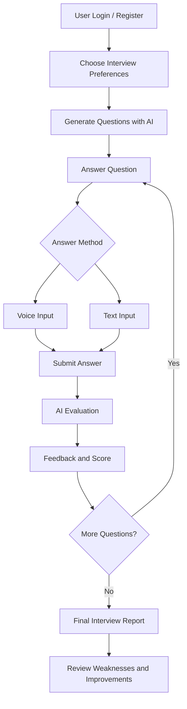
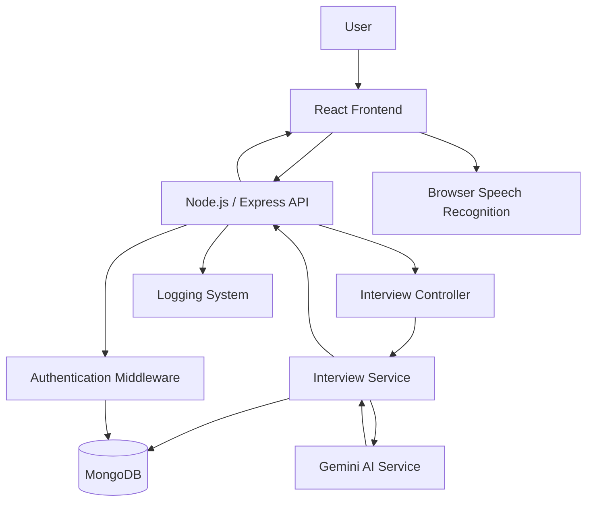
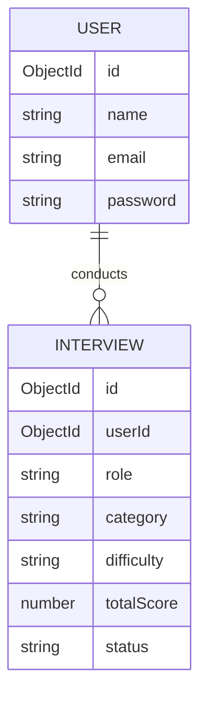
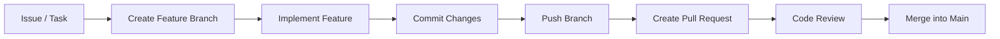

<div align="center">

# InterviewMate AI

### AI-Powered Mock Interview & Performance Analysis Platform

Practice interviews. Understand your weaknesses. Improve with AI-powered feedback.


</div>

---

## 📌 About the Project

InterviewMate AI is an AI-powered mock interview platform designed to help students and job seekers practice interviews in a realistic environment.

Users can select their desired job role, interview category, and difficulty level. The platform generates relevant interview questions, accepts answers through voice or text, and uses AI to evaluate responses.

Instead of simply telling users whether an answer is correct or incorrect, InterviewMate AI provides detailed feedback, identifies missing concepts, highlights strengths and weaknesses, and suggests ways to improve.

The goal is to make interview preparation more personalized, structured, and effective.

---

## ❓ Problem Statement

Preparing for technical interviews can be difficult without access to an interviewer or meaningful feedback.

Candidates often:

- Practice questions without knowing whether their answers are good enough.
- Struggle to identify gaps in their technical knowledge.
- Receive no feedback on the structure or clarity of their answers.
- Find it difficult to track their improvement over time.
- Feel nervous during actual interviews due to a lack of practice.

## 💡 Our Solution

InterviewMate AI provides a virtual interview practice environment where candidates can:

- Practice role-specific interview questions.
- Answer using voice or text.
- Receive AI-powered answer evaluations.
- Understand their mistakes and missing concepts.
- View interview performance reports.
- Identify topics that need further preparation.

---

## ✨ Key Features

| Feature | Description |
|---|---|
| 🎯 Personalized Interviews | Generate questions based on role, category, and difficulty |
| 🤖 AI Question Generation | Generate relevant interview questions using Gemini |
| 🎤 Voice-Based Answers | Answer questions using browser speech recognition |
| ✍️ Text-Based Answers | Type answers as an alternative to voice input |
| 🧠 AI Answer Evaluation | Analyze answers for accuracy, relevance, clarity, and completeness |
| 📊 Performance Analysis | View scores and detailed feedback |
| 💪 Strength Identification | Understand concepts answered well |
| 📉 Weakness Identification | Identify mistakes and missing concepts |
| 📚 Improvement Suggestions | Receive actionable recommendations |
| 📜 Interview History | Review previous interview sessions |
| 🔐 Secure Authentication | User authentication with JWT and password hashing |

---

## 🔄 How It Works



---

## 👤 User Journey

1. Register or log in to the platform.
2. Select the target job role.
3. Choose an interview category and difficulty.
4. Start the interview.
5. Read the generated question.
6. Respond using voice or text.
7. Submit the answer for evaluation.
8. Receive feedback and move to the next question.
9. Complete the interview.
10. Review the final performance report.

---

## 🏗️ System Architecture



### Architecture Components

| Component | Responsibility |
|---|---|
| Frontend | Interview interface, dashboard, forms, reports |
| Backend API | Handles application requests and business logic |
| Authentication | Validates users and protects private routes |
| Interview Service | Manages interview sessions and question flow |
| Gemini Service | Generates questions and evaluates answers |
| MongoDB | Stores users, interviews, answers, and evaluations |
| Speech Recognition | Converts voice answers into text in the browser |
| Logging System | Tracks requests, errors, latency, and service failures |

---

## 🧠 AI Workflow

### 1. Question Generation

The user selects:

- Job role
- Interview category
- Difficulty level
- Number of questions

The AI generates questions based on these preferences.

Example:

| Input | Value |
|---|---|
| Role | Software Engineer |
| Category | Data Structures & Algorithms |
| Difficulty | Intermediate |
| Questions | 5 |

### 2. Answer Collection

Users can submit answers in two ways:

- **Voice:** Speech is converted into text using the browser's Speech Recognition API.
- **Text:** Users type their answer directly.

Voice transcripts can be reviewed and edited before submission.

### 3. AI Evaluation

Each answer is evaluated using multiple criteria.

| Evaluation Criteria | What It Measures |
|---|---|
| Technical Accuracy | Correctness of the concepts |
| Relevance | Whether the answer addresses the question |
| Completeness | Whether important points are covered |
| Clarity | How understandable the explanation is |
| Structure | How logically the answer is presented |

### 4. Feedback Generation

For each answer, the system generates:

- Score
- Strengths
- Weaknesses
- Missing concepts
- Explanation of mistakes
- Improvement suggestions
- Example of a stronger answer

### 5. Final Performance Report

After the interview, the system combines individual evaluations to generate an overall report.

The report may include:

- Overall performance score
- Question-wise scores
- Strongest areas
- Weakest areas
- Recurring mistakes
- Recommended topics to revise

---

## 📊 Example AI Evaluation

An answer may be evaluated and returned in the following structured format:

```json
{
  "score": 7,
  "technicalAccuracy": 8,
  "relevance": 7,
  "clarity": 6,
  "completeness": 6,
  "strengths": [
    "Correctly explained the basic concept",
    "Provided a relevant example"
  ],
  "weaknesses": [
    "Did not discuss time complexity",
    "Explanation lacked sufficient detail"
  ],
  "missingConcepts": [
    "Edge cases",
    "Time complexity analysis"
  ],
  "suggestions": [
    "Explain the time complexity",
    "Include a dry run with an example"
  ],
  "improvedAnswer": "A more structured and complete example answer..."
}
```

> The evaluation format is a proposed response structure. Actual fields may change during implementation.

---

## 🗄️ Database Design

### User Collection

Stores user account information.

| Field | Type | Description |
|---|---|---|
| _id | ObjectId | Unique user ID |
| name | String | User's name |
| email | String | Unique email address |
| password | String | Hashed password |
| createdAt | Date | Account creation timestamp |

### Interview Collection

Stores interview sessions and evaluation data.

| Field | Type | Description |
|---|---|---|
| _id | ObjectId | Unique interview ID |
| userId | ObjectId | Reference to user |
| role | String | Selected job role |
| category | String | Interview category |
| difficulty | String | Selected difficulty |
| questions | Array | Generated questions |
| answers | Array | Submitted answers |
| evaluations | Array | AI feedback |
| totalScore | Number | Overall score |
| status | String | Interview status |
| createdAt | Date | Interview creation timestamp |

### Database Relationship



---

## 🔌 API Endpoints

### Authentication

| Method | Endpoint | Description | Access |
|---|---|---|---|
| POST | `/api/auth/register` | Register a new user | Public |
| POST | `/api/auth/login` | Login user | Public |
| GET | `/api/auth/me` | Get current user | Protected |

### Interviews

| Method | Endpoint | Description | Access |
|---|---|---|---|
| POST | `/api/interviews` | Create an interview | Protected |
| GET | `/api/interviews` | Get interview history | Protected |
| GET | `/api/interviews/:id` | Get interview details | Protected |
| POST | `/api/interviews/:id/answer` | Submit and evaluate answer | Protected |
| POST | `/api/interviews/:id/next` | Move to next question | Protected |
| POST | `/api/interviews/:id/complete` | Complete interview | Protected |
| DELETE | `/api/interviews/:id` | Delete an interview | Protected |

### System

| Method | Endpoint | Description |
|---|---|---|
| GET | `/api/health` | Check server status |

> These endpoints represent the planned API structure and may change during development.

---

## 🛠️ Tech Stack

### Frontend

| Technology | Purpose |
|---|---|
| React | Component-based UI |
| Vite | Development server and build tool |
| Tailwind CSS | Styling and responsive layouts |
| Recharts | Performance visualizations |
| Web Speech API | Voice-to-text functionality |

### Backend

| Technology | Purpose |
|---|---|
| Node.js | Runtime environment |
| Express.js | REST API and server |
| MongoDB | Database |
| Mongoose | MongoDB object modeling |
| JWT | Authentication |
| bcrypt | Password hashing |
| Winston | Application logging |

### AI & Tools

| Tool | Purpose |
|---|---|
| Google Gemini API | Question generation and answer evaluation |
| Postman | API testing |
| Git | Version control |
| GitHub | Collaboration and project hosting |

---

## 📁 Project Structure

```text
InterviewMate-AI/
│
├── client/
│   ├── public/
│   └── src/
│       ├── assets/
│       ├── components/
│       ├── pages/
│       ├── hooks/
│       ├── services/
│       ├── context/
│       ├── utils/
│       └── App.jsx
│
├── server/
│   ├── config/
│   ├── controllers/
│   ├── middleware/
│   ├── models/
│   ├── routes/
│   ├── services/
│   │   ├── geminiService.js
│   │   └── interviewService.js
│   ├── utils/
│   │   └── logger.js
│   ├── app.js
│   └── server.js
│
├── docs/
│
├── .gitignore
└── README.md
```

---

## 🚀 Getting Started

### Prerequisites

Install the following before running the project:

- Node.js (LTS)
- npm
- MongoDB (local installation or MongoDB Atlas)
- Git
- Google Gemini API key

### 1. Clone the Repository

```bash
git clone https://github.com/YOUR_USERNAME/InterviewMate-AI.git
```

```bash
cd InterviewMate-AI
```

### 2. Install Dependencies

Install backend dependencies:

```bash
cd server
npm install
```

Install frontend dependencies:

```bash
cd ../client
npm install
```

### 3. Configure Environment Variables

Create a `.env` file inside the `server` folder.

```env
PORT=5000
MONGO_URI=your_mongodb_connection_string
JWT_SECRET=your_secure_secret_key
GEMINI_API_KEY=your_gemini_api_key
NODE_ENV=development
```

> Never commit your `.env` file or expose API keys in the frontend.

### 4. Run the Backend

```bash
cd server
npm run dev
```

### 5. Run the Frontend

Open another terminal:

```bash
cd client
npm run dev
```

### 6. Open the Application

Open the local URL displayed by Vite, usually:

```text
http://localhost:5173
```

---

## 🔒 Security

InterviewMate AI aims to follow basic security practices:

- Password hashing using bcrypt.
- JWT-based authentication.
- Protected API endpoints.
- Input validation.
- Environment variables for secrets.
- User-specific access to interview history.
- Secure handling of AI API credentials.
- Error handling without exposing sensitive information.

---

## 📈 Development Roadmap

### Phase 1 — Foundation

- [ ] Repository setup
- [ ] Frontend and backend initialization
- [ ] MongoDB connection
- [ ] Environment configuration
- [ ] Basic UI layout

### Phase 2 — Authentication

- [ ] Registration
- [ ] Login
- [ ] Password hashing
- [ ] JWT authentication
- [ ] Protected routes

### Phase 3 — Interview Engine

- [ ] Interview configuration
- [ ] AI question generation
- [ ] Question navigation
- [ ] Text answer submission
- [ ] Voice input integration

### Phase 4 — AI Evaluation

- [ ] Gemini integration
- [ ] Structured evaluation prompts
- [ ] Answer scoring
- [ ] Strengths and weaknesses
- [ ] Improvement recommendations

### Phase 5 — Dashboard & Reports

- [ ] Interview history
- [ ] Interview detail page
- [ ] Score visualizations
- [ ] Final performance report
- [ ] Weak-topic analysis

### Phase 6 — Testing & Deployment

- [ ] API testing
- [ ] Frontend testing
- [ ] Integration testing
- [ ] Error handling
- [ ] Deployment
- [ ] Documentation updates

---

## 🔮 Future Enhancements

- Adaptive question difficulty
- Resume-based question generation
- Follow-up questions based on previous answers
- Behavioral interviews using STAR evaluation
- Coding interview practice
- AI interviewer with conversational interaction
- Text-to-speech interviewer
- Personalized learning roadmap
- Performance trends across multiple interviews
- Multi-language support

---

## 👥 Team

<table>
<tr>
<td align="center" width="50%">

### Vrushali Parmar

**Backend Development & AI Integration**

- Backend architecture and REST APIs
- Authentication and authorization
- MongoDB schema design
- Gemini API integration
- AI prompts and evaluation logic
- Backend testing and debugging

</td>

<td align="center" width="50%">

### Saurabh

**Frontend Development & User Experience**

- React application development
- UI/UX design
- Interview dashboard
- Interview flow and interactions
- Voice input integration
- Frontend testing and integration

</td>
</tr>
</table>

Both contributors collaborate on system design, feature integration, testing, code reviews, and deployment.

---

## 🤝 Contribution Workflow

We follow a collaborative Git workflow.



### Branch Naming

```text
feature/authentication
feature/interview-dashboard
feature/ai-evaluation
fix/api-error
docs/readme-update
```

### Commit Convention

```text
feat: add interview question generation
fix: resolve login validation error
docs: update installation instructions
refactor: improve interview service
test: add authentication tests
```

---

## 📌 Project Status

InterviewMate AI is currently under active development.

The features, architecture, and API specifications documented here represent our development plan. Features will be marked as implemented only after they are developed and tested.

---

<div align="center">

## InterviewMate AI

**Practice smarter. Interview better. Grow confidently.**

Built with ❤️ by Vrushali & Saurabh

</div>
