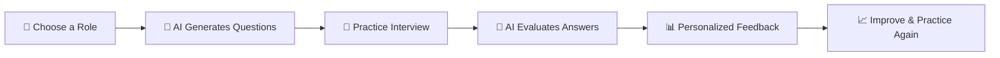
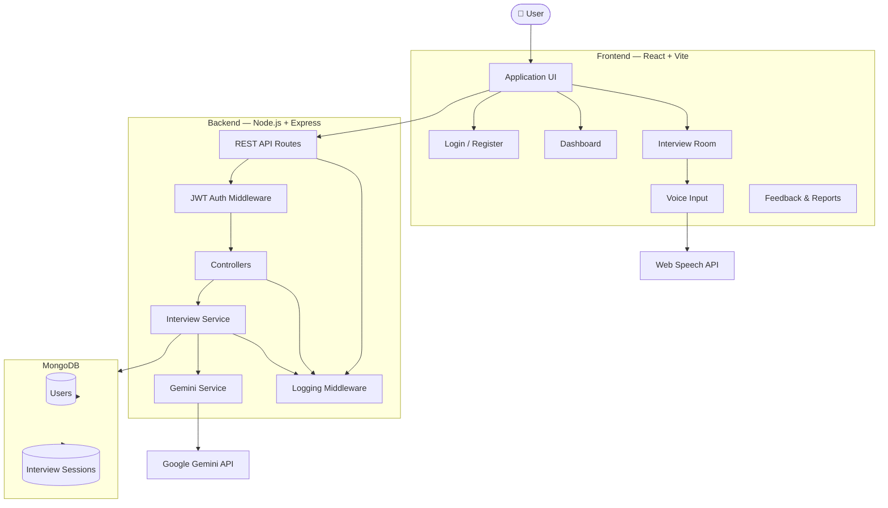
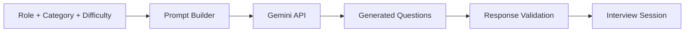
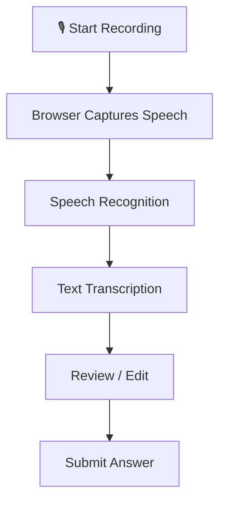
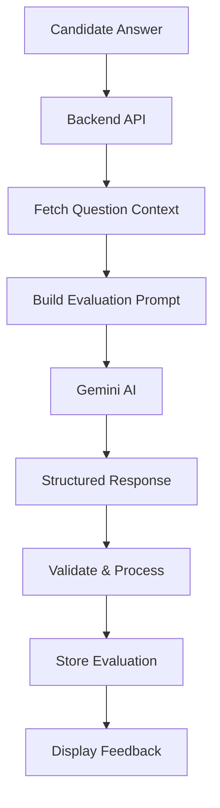
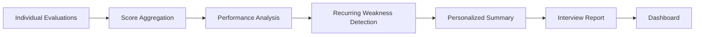
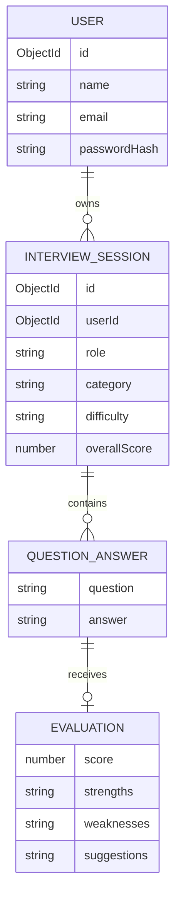
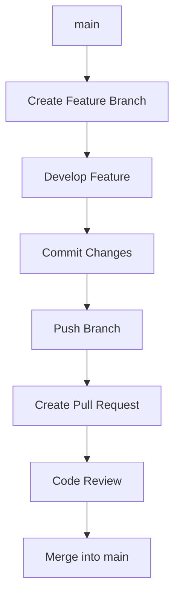

<!-- ===================== HERO SECTION ===================== -->
<div align="center">


<a href="https://git.io/typing-svg">
  
</a>

<br/>

<p>
  An intelligent mock interview platform that helps candidates prepare for interviews
  through role-based questions, voice-enabled answering, and personalized AI feedback.
</p>

<br/>


<br/>

**[Overview](#-overview) • [Features](#-features) • [Architecture](#-system-architecture) • [AI-engine](#-ai-engine) • [Roadmap](#-roadmap)**

</div>

---

<!-- ===================== OVERVIEW ===================== -->

## ✦ Overview

Interviews are not just about knowing the answer — they are about communicating your knowledge clearly, thinking under pressure, and structuring your responses effectively.

But practicing alone has its limitations.

You might know a concept but struggle to explain it. You might complete an interview without knowing what you did well or what needs improvement.

**InterviewMate AI** is built to bridge that gap.

It provides an interactive interview environment where users can select a job role, answer AI-generated interview questions through voice or text, and receive detailed feedback on their performance.

Instead of simply practicing more, users can understand **how they practice, where they struggle, and how they can improve.**

---

## ✧ The Problem

<div align="center">

| 🎯 Challenge | 💭 Why it matters |
|:---|:---|
| Lack of interview practice | Candidates rarely experience realistic interview scenarios |
| No personalized feedback | Mistakes and knowledge gaps go unnoticed |
| Communication difficulties | Correct knowledge may be poorly explained |
| Repetitive preparation | Candidates don't know what to focus on next |
| No progress tracking | Improvement across practice sessions is difficult to measure |
| Limited mock interview access | Personal mentors and interview partners aren't always available |

</div>

## ✧ Our Solution

We are building an AI-powered interview companion that makes interview practice accessible, interactive, and measurable.



---

## ✦ Features

<table>
<tr>
<td width="50%">

### 🔐 Secure Authentication
- User registration & login
- Password hashing
- JWT-based authentication
- Protected routes
- Personal interview history

</td>
<td width="50%">

### 🎯 Role-Based Interviews
- Choose a job role
- Select interview category
- Configure difficulty
- AI-generated questions
- Customized interview sessions

</td>
</tr>
<tr>
<td width="50%">

### 🎙️ Voice-Based Practice
- Microphone input
- Speech-to-text transcription
- Editable answers
- Text-input fallback
- Interactive interview experience

</td>
<td width="50%">

### 🧠 AI-Powered Evaluation
- Technical accuracy
- Relevance & clarity
- Answer completeness
- Strengths & weaknesses
- Actionable improvement suggestions

</td>
</tr>
<tr>
<td width="50%">

### 📊 Performance Dashboard
- Interview scores
- Performance breakdown
- Areas of improvement
- Visual analytics
- Previous interview reports

</td>
<td width="50%">

### ⚙️ Backend Monitoring
- Structured logging
- Request tracking
- Response-time monitoring
- Error logging
- AI service failure handling

</td>
</tr>
</table>

---

## ✦ User Experience

### 01 — Choose your interview

Select the role, interview domain, and difficulty level you want to practice.

### 02 — Meet your questions

InterviewMate generates relevant questions based on your selected role and interview configuration.

### 03 — Answer naturally

Speak your answer using your microphone or type it manually. Review your voice transcription and edit it if needed.

### 04 — Get intelligent feedback

Receive an AI-powered evaluation with scores, strengths, weaknesses, missing concepts, and improvement suggestions.

### 05 — Track your growth

Review previous sessions, understand recurring weaknesses, and focus on the areas that need improvement.

---

## ✦ System Architecture



### Architecture Responsibilities

| Component | Responsibility |
|---|---|
| React Frontend | User interface and interview experience |
| Speech Recognition | Convert spoken responses into text |
| Express API | Handle requests, validation, and application logic |
| JWT Middleware | Verify user identity and route access |
| Interview Service | Manage questions, answers, and session progression |
| Gemini Service | Generate questions and evaluate candidate responses |
| MongoDB | Persist user data, sessions, and feedback |
| Logging Middleware | Track requests, latency, errors, and events |

---

## ✦ AI Engine

AI is not just used to generate text. It powers the interview lifecycle — from question generation to answer evaluation and final performance analysis.

### ① Interview Question Generation



**Input parameters**

- Job role
- Interview category
- Difficulty level
- Number of questions
- Interview context

**Output**

A structured list of relevant interview questions tailored to the selected interview configuration.

---

### ② Voice Answer Processing



Voice input will use the browser's speech recognition capabilities.

The candidate's speech is converted into text, which can be reviewed and corrected before submission.

Text input will also be available as an alternative.

---

### ③ AI Answer Evaluation



Each response will be evaluated using a consistent rubric.

| Evaluation Metric | Description |
|---|---|
| Technical Accuracy | Correctness of concepts and information |
| Relevance | How directly the answer addresses the question |
| Clarity | How understandable the explanation is |
| Completeness | Whether important concepts are covered |
| Structure | Logical organization of the answer |

### ④ Personalized Feedback

The AI evaluation will provide:

- Overall answer score
- Individual criterion scores
- Strengths
- Weaknesses
- Missing concepts
- Actionable improvement suggestions
- A sample improved answer

### Example Evaluation Response

```json
{
  "score": 78,
  "criteria": {
    "technicalAccuracy": 8,
    "relevance": 9,
    "clarity": 7,
    "completeness": 7,
    "structure": 8
  },
  "strengths": [
    "Correctly explained the core concept",
    "Provided a relevant example"
  ],
  "weaknesses": [
    "Missed an important edge case",
    "Explanation could be more structured"
  },
  "missingConcepts": [
    "Time complexity analysis"
  ],
  "suggestions": [
    "Explain the trade-offs between approaches",
    "Include complexity analysis"
  ],
  "improvedAnswer": "An example of a clearer and more complete answer..."
}
```

> Example output only. Actual feedback will be generated by the AI based on the submitted response and evaluation criteria.

---

### ⑤ Final Performance Report

Individual answer evaluations are combined to identify patterns across the entire interview.



The goal is to go beyond a score and help the user answer:

- What am I good at?
- What do I consistently struggle with?
- Which concepts should I revise?
- How can I improve my next interview?

---

## ✦ Prompt Engineering

We aim to make AI feedback structured, consistent, and useful rather than vague or overly encouraging.

### Question Generation Prompt

The AI will receive:

- Selected job role
- Interview category
- Difficulty level
- Number of questions
- Expected interviewer style

It will be instructed to generate relevant, non-repetitive questions suitable for the selected interview.

### Answer Evaluation Prompt

The evaluation context will contain:

- The selected role
- The interview category
- The question asked
- The candidate's answer
- The evaluation rubric

The AI will be instructed to:

- Evaluate fairly and consistently
- Avoid inflated scores
- Identify incorrect claims
- Identify missing concepts
- Avoid inventing mistakes
- Provide constructive feedback
- Return structured JSON
- Provide suggestions that are specific to the candidate's response

<details>
<summary>📝 View sample evaluation prompt</summary>

```text
You are an experienced technical interviewer conducting a mock interview.

Role: Software Engineer
Category: Data Structures and Algorithms
Difficulty: Intermediate

Question:
Explain the difference between a stack and a queue.

Candidate Answer:
{{candidate_answer}}

Evaluate the answer based on:

1. Technical accuracy
2. Relevance
3. Clarity
4. Completeness
5. Structure

For each criterion, assign a score from 0 to 10.

Provide:
- Overall score from 0 to 100
- Strengths
- Weaknesses
- Missing concepts
- Actionable improvement suggestions
- A sample improved answer

Rules:
- Be fair and objective.
- Do not give high scores to incomplete or incorrect answers.
- Do not invent mistakes.
- Avoid generic feedback.
- Evaluate only the answer provided.

Return valid JSON matching the expected schema.
```

</details>

---

## ✦ Data Model

### User

```json
{
  "_id": "user_id",
  "name": "Candidate Name",
  "email": "candidate@example.com",
  "passwordHash": "bcrypt_hash",
  "createdAt": "timestamp"
}
```

### Interview Session

```json
{
  "_id": "interview_id",
  "userId": "user_id",
  "role": "Software Engineer",
  "category": "DSA",
  "difficulty": "Intermediate",
  "status": "completed",
  "questions": [
    {
      "questionText": "Explain the concept of a stack.",
      "answerText": "Candidate's response",
      "evaluation": {
        "score": 78,
        "strengths": [],
        "weaknesses": [],
        "missingConcepts": [],
        "suggestions": []
      }
    }
  ],
  "overallScore": 78,
  "createdAt": "timestamp",
  "completedAt": "timestamp"
}
```

### Database Relationship



---

## ✦ API Design

### Authentication

| Method | Endpoint | Description | Access |
|---|---|---|---|
| `POST` | `/api/auth/register` | Register a new user | Public |
| `POST` | `/api/auth/login` | Authenticate user | Public |
| `GET` | `/api/auth/me` | Fetch current user | Protected |

### Interviews

| Method | Endpoint | Description |
|---|---|---|
| `POST` | `/api/interviews` | Create an interview |
| `GET` | `/api/interviews` | Get interview history |
| `GET` | `/api/interviews/:id` | Get interview details |
| `POST` | `/api/interviews/:id/answer` | Submit & evaluate an answer |
| `POST` | `/api/interviews/:id/next` | Advance interview |
| `POST` | `/api/interviews/:id/complete` | Complete interview & generate report |
| `DELETE` | `/api/interviews/:id` | Delete an interview |

### Health Check

| Method | Endpoint | Description |
|---|---|---|
| `GET` | `/api/health` | Check backend health |

> API design may evolve as implementation progresses.

---

## ✦ Logging & Performance

We aim to build an application that is not only functional, but also observable and maintainable.

### Structured Logging

Winston will be used to record backend events in a structured format.

```json
{
  "level": "info",
  "message": "Evaluation completed",
  "requestId": "req_123",
  "durationMs": 1850,
  "statusCode": 200
}
```

### Monitoring

| Metric | Purpose |
|---|---|
| API response time | Identify slow requests |
| Gemini response time | Monitor AI latency |
| Request volume | Understand application usage |
| Error rate | Track failures |
| Authentication failures | Monitor auth events |
| Database latency | Detect inefficient queries |

### Optimization Approach

- Asynchronous processing using `async/await`
- Efficient MongoDB queries
- Avoid duplicate AI requests
- Validate requests before AI calls
- Timeout handling
- Retry logic for transient failures
- Pagination for interview history
- Consistent error handling
- Structured logs for debugging

---

## ✦ Security

Security will be incorporated throughout the application.

- 🔐 Password hashing with bcrypt
- 🔑 JWT-based authentication
- 🛡️ Protected API routes
- 🔒 Environment-based secret management
- 🚫 API keys never exposed to the frontend
- ✅ Input validation
- ⏱️ Rate limiting for sensitive endpoints
- 👤 User-specific data access
- 🧹 Sensitive information excluded from logs

---

## ✦ Tech Stack

<div align="center">

| Layer | Technology |
|---|---|
| Frontend | React |
| Build Tool | Vite |
| Styling | Tailwind CSS |
| Backend | Node.js |
| API Framework | Express.js |
| Database | MongoDB |
| ODM | Mongoose |
| AI | Google Gemini API |
| Authentication | JWT |
| Password Hashing | bcrypt |
| Voice Input | Web Speech API |
| Logging | Winston |
| Data Visualization | Recharts |
| API Testing | Postman |
| Version Control | Git & GitHub |

</div>

---

## ✦ Project Structure

```text
InterviewMate-AI/
│
├── client/
│   ├── public/
│   └── src/
│       ├── assets/
│       ├── components/
│       │   ├── common/
│       │   ├── dashboard/
│       │   ├── interview/
│       │   └── feedback/
│       ├── pages/
│       ├── hooks/
│       ├── services/
│       ├── context/
│       └── App.jsx
│
├── server/
│   └── src/
│       ├── config/
│       ├── controllers/
│       ├── middleware/
│       ├── models/
│       ├── routes/
│       ├── services/
│       │   ├── geminiService.js
│       │   └── interviewService.js
│       ├── utils/
│       ├── logs/
│       └── app.js
│
├── docs/
│   ├── architecture.md
│   └── api.md
│
├── .gitignore
└── README.md
```

---

## ✦ Getting Started

### Prerequisites

Make sure you have installed:

- [Node.js](https://nodejs.org/)
- npm
- [MongoDB](https://www.mongodb.com/)
- [Google AI Studio API Key](https://aistudio.google.com/)
- [Git](https://git-scm.com/)

### 1. Clone the repository

```bash
git clone https://github.com/YOUR_USERNAME/InterviewMate-AI.git

cd InterviewMate-AI
```

### 2. Install Frontend Dependencies

```bash
cd client
npm install
```

### 3. Install Backend Dependencies

```bash
cd ../server
npm install
```

### 4. Configure Environment Variables

Create a `.env` file inside the `server` directory.

```env
PORT=5000
NODE_ENV=development

MONGODB_URI=your_mongodb_connection_string

JWT_SECRET=your_secure_secret

GEMINI_API_KEY=your_gemini_api_key

CLIENT_URL=http://localhost:5173
```

> ⚠️ Never commit your `.env` file or expose your API keys.

### 5. Start the Backend

```bash
cd server
npm run dev
```

### 6. Start the Frontend

Open another terminal:

```bash
cd client
npm run dev
```

### 7. Launch the Application

```text
http://localhost:5173
```

---

## ✦ Development Roadmap

<details>
<summary><b>🟢 Phase 1 — Project Foundation</b></summary>

- [ ] Finalize project requirements
- [ ] Define architecture
- [ ] Create GitHub repository
- [ ] Setup React frontend
- [ ] Setup Express backend
- [ ] Connect MongoDB
- [ ] Establish team workflow

</details>

<details>
<summary><b>🔵 Phase 2 — Authentication</b></summary>

- [ ] Registration endpoint
- [ ] Login endpoint
- [ ] bcrypt password hashing
- [ ] JWT generation & verification
- [ ] Protected routes
- [ ] Frontend authentication flow

</details>

<details>
<summary><b>🟣 Phase 3 — Interview Engine</b></summary>

- [ ] Interview configuration UI
- [ ] Role selection
- [ ] Difficulty selection
- [ ] Gemini question generation
- [ ] Interview session creation
- [ ] Question progression
- [ ] Interview state management

</details>

<details>
<summary><b>🟠 Phase 4 — AI Evaluation</b></summary>

- [ ] Evaluation rubric
- [ ] Prompt engineering
- [ ] Structured AI output
- [ ] JSON validation
- [ ] Answer scoring
- [ ] Feedback generation
- [ ] Error handling

</details>

<details>
<summary><b>🟡 Phase 5 — Voice & Reports</b></summary>

- [ ] Microphone permissions
- [ ] Speech-to-text
- [ ] Editable transcript
- [ ] Text input fallback
- [ ] Individual answer reports
- [ ] Overall performance report
- [ ] Strength & weakness analysis

</details>

<details>
<summary><b>🔴 Phase 6 — Dashboard & Quality</b></summary>

- [ ] Interview history
- [ ] Score visualization
- [ ] Performance dashboard
- [ ] Structured logging
- [ ] API testing
- [ ] Error handling
- [ ] Security testing
- [ ] Responsive design
- [ ] Deployment

</details>

---

## ✦ Future Enhancements

> Planned beyond the initial MVP.

- 💬 Conversational AI interviewer
- 🔄 Dynamic follow-up questions
- 📄 Resume-based interview generation
- 🏢 Company-specific interview modes
- 💻 Coding interview environment
- ⭐ Behavioral interviews with STAR evaluation
- 📉 Adaptive interview difficulty
- 📈 Long-term progress analytics
- 🗺️ Personalized learning roadmap
- 🔊 AI interviewer text-to-speech
- 🌐 Multi-language support

---

## ✦ Team

<table>
<tr>
<td align="center" width="50%">

### 👩‍💻 Vrushali Parmar

**Backend Development · AI Integration**

- Backend architecture
- REST API development
- Authentication & authorization
- Database design
- Gemini API integration
- Prompt engineering & evaluation
- Structured logging
- Backend testing & optimization

</td>
<td align="center" width="50%">

### 👨‍💻 Saurabh

**Frontend Development · User Experience**

- Frontend architecture
- UI/UX implementation
- Authentication screens
- Interview dashboard
- Interview experience
- Voice input integration
- Feedback visualization
- Frontend testing & integration

</td>
</tr>
</table>

### 🤝 Collaborative Work

Both contributors will participate in:

- System design decisions
- AI evaluation strategy
- Integration testing
- Code reviews
- Debugging & problem solving
- Deployment
- Documentation

---

## ✦ Contribution Workflow

We follow a feature-based Git workflow to keep development organized.



### Branch Naming

```text
feature/authentication
feature/gemini-integration
feature/interview-dashboard
feature/voice-input

fix/api-error-handling
fix/interview-score-calculation
```

### Commit Convention

```text
feat: add user authentication
feat: integrate gemini question generation
fix: handle empty interview answers
docs: update project readme
refactor: separate ai service logic
test: add authentication api tests
```

---

## ✦ Why InterviewMate AI?

InterviewMate AI is an end-to-end software engineering project focused on building something practical.

It combines:

- Full-stack web development
- REST API architecture
- Secure authentication
- Database modeling
- AI integration
- Prompt engineering
- Speech recognition
- Structured AI evaluation
- Performance analytics
- Logging and monitoring
- Team-based Git workflows

The goal is not simply to generate interview questions using AI.

**The goal is to build a system that helps users understand their performance and improve with every interview.**

---

<div align="center">


### InterviewMate AI

**Practice smarter. Interview better. Grow with every answer.**

<sub>Built with curiosity, collaboration, and a little help from AI. 💙</sub>

</div>
